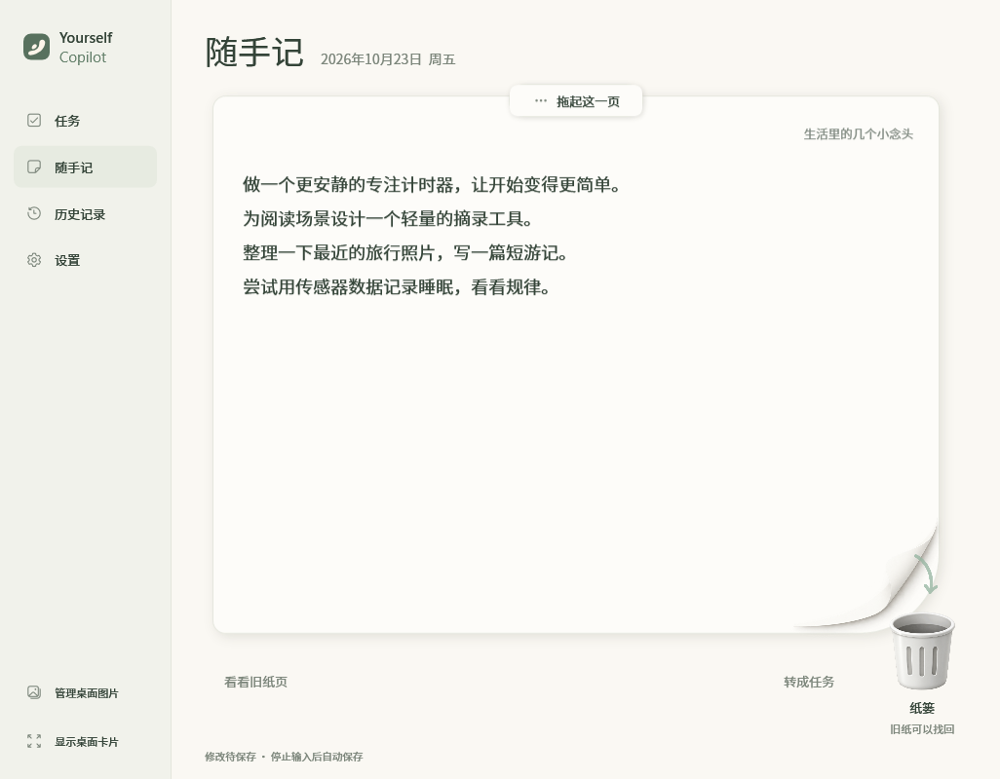
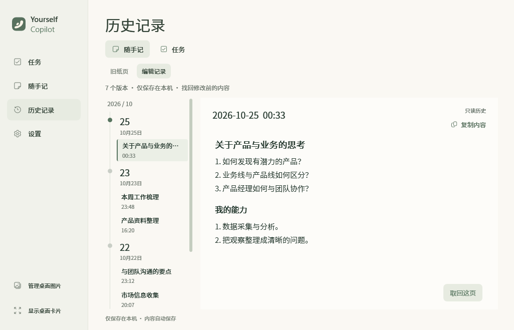

  

<h1 align="center">Yourself Copilot</h1>

<strong>让任务看得见，让想法有处落笔。</strong>

把待办、随手记和参考图片留在桌面上，随时记录，慢慢完成。

  <a href="https://github.com/IsaacPu/Yourself-Copilot/releases/tag/v0.2.0">v0.2.0</a>
  · Windows 10 / 11 x64
  · 本地保存
  · 免安装

  <a href="https://github.com/IsaacPu/Yourself-Copilot/releases/latest/download/Yourself-Copilot-windows-x64.zip"><strong>下载 Windows 版</strong></a>
  &nbsp; · &nbsp; <a href="docs/USAGE.md">使用指南</a>
  &nbsp; · &nbsp; <a href="CHANGELOG.md">更新日志</a>

  

一张可以写标题、收好、再取回的纸。以下界面均使用演示内容。

## 留给每天的三件事

| | 可以怎样用 |
| --- | --- |
| **安排任务** | 按今天、明天和以后安排待办，完成后勾选，也能改期或撤销移除。之前未完成的任务会在今天单列，保留原计划日期。 |
| **记下想法** | 在纸页上自由书写，右上角填写标题；选中文字可转成任务。写完后把整页拖入纸篓，换一张空白纸继续。 |
| **回看与找回** | 旧纸页可连同标题取回，编辑记录用于恢复修改前的内容；任务历史单独查看已提交的任务及状态。 |

### 把眼前的事放在桌面上

桌面卡片同时容纳任务和随手记，可以移动、缩放、锁定或隐藏。任务与长记事分别滚动，中间的手柄可调整两块区域的高度。参考图片也能单独放在桌面上，保留原有壁纸。

  

### 写过的内容，有迹可循

随手记历史分为 **旧纸页** 和 **编辑记录**。放入纸篓的纸页仍可找回，取回时会先保护当前非空页；支持 `Ctrl+Z` 撤销、`Ctrl+Y` 重做纸页切换，正在编辑的文字优先使用文字撤销。

当前内容自动保存，历史则把连续编辑按句段合并；任务在提交保存后才进入历史。随手记在同一分钟的多条记录默认折叠，可按需展开。按日期和摘要浏览，右键条目可修改标题，原文和快照时间保留。

  

## 下载与开始

1. [下载 Windows 免安装包](https://github.com/IsaacPu/Yourself-Copilot/releases/latest/download/Yourself-Copilot-windows-x64.zip)，**完整解压**到有写入权限的文件夹。
2. 双击 `Yourself Copilot.exe`，添加第一个任务，或在随手记里写下想法。
3. 按需在设置中开启登录自动运行，让桌面卡片随 Windows 登录显示。

需要 **Windows 10 / 11（64 位）及 .NET Framework 4.8 或更高版本**。无需编译、注册账号或配置 API Key。

请保留解压后的所有文件和资源文件夹。日常使用下载文件名为 `Yourself-Copilot-windows-x64.zip` 的应用包；GitHub 的 “Code → Download ZIP” 和 Release 中的 “Source code” 提供源码。

关闭工作台后，程序会继续驻留托盘。双击托盘图标重新打开，完整退出请选择托盘菜单中的“退出 Yourself Copilot”。

## 数据与更新

任务、随手记、图片和历史保存在**程序所在文件夹**，目前没有云端同步，本地文件未加密。迁移或备份时，先退出程序，再复制整个文件夹。

更新时先备份旧目录，再用新版本的程序和资源覆盖同名文件，**保留个人数据文件、`images/` 和 `history/`**。如果换到新文件夹运行，需手动迁入原有数据。具体文件清单和步骤见 [数据与备份](docs/USAGE.md#数据与备份) 与 [更新版本](docs/USAGE.md#更新版本)。

## 开发与反馈

使用 **C# · .NET Framework · WinForms / WPF** 构建。源码位于 `src/`，构建入口与验证方法见 [开发文档](docs/DEVELOPMENT.md)。当前为本地桌面工具，尚未接入 AI 或 Codex。

| 文档 | 内容 |
| --- | --- |
| [使用指南](docs/USAGE.md) | 任务、纸页、快捷键、托盘、数据与更新 |
| [开发与构建](docs/DEVELOPMENT.md) | 源码结构、构建、测试与打包 |
| [更新日志](CHANGELOG.md) | 各版本的功能与修复 |
| [v0.2.0 发布审查](docs/design/release-0.2.0.md) | 本版本的验证结果与适用范围 |
| [问题反馈](https://github.com/IsaacPu/Yourself-Copilot/issues) | 提供版本号、Windows 版本和复现步骤 |

项目代码暂未指定开源许可证；字体、图标等随附资源按各自许可证分发，见 [第三方资源说明](docs/THIRD-PARTY-NOTICES.txt)。
