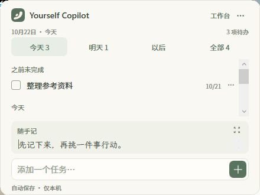

  

<h1 align="center">Yourself Copilot</h1>

把任务、想法和参考图片，留在每天看得见的桌面上。

  <a href="https://github.com/IsaacPu/Yourself-Copilot/releases/latest/download/Yourself-Copilot-windows-x64.zip"><strong>下载 Windows 免安装版（ZIP）</strong></a>
  · <a href="https://github.com/IsaacPu/Yourself-Copilot/releases">更新记录</a>

  

## 开始使用

1. 下载上方 ZIP，**完整解压**到有写入权限的文件夹。
2. 双击 `Yourself Copilot.exe`，添加任务或写下备忘。
3. 在设置中选择是否登录 Windows 后自动显示桌面卡片。

适用于 **Windows 10 / 11，64 位**，需要 .NET Framework 4.8 或更高版本。无需编译、注册账号或配置 API Key。

普通使用请下载 **Releases 中的应用 ZIP**；GitHub 的 “Code → Download ZIP” 和 Release 中的 “Source code” 是源码。

## 主要功能

- **今天、明天、以后**：安排任务，勾选完成，随时改期或撤销移除。
- **随手记**：记录想法，将选中文字转成任务。
- **桌面卡片与图片**：移动、缩放、锁定或隐藏，保留原有壁纸。
- **本地保存与历史**：自动保存，查看旧内容，从托盘随时打开。

数据保存在程序文件夹内。关闭工作台后会继续驻留托盘；完整退出请使用托盘菜单。更新前请先退出并备份文件夹，详见 [使用与更新](docs/USAGE.md)。

当前为本地桌面工具，尚未接入 AI、Codex 或云端同步。

[使用与更新](docs/USAGE.md) · [开发与构建](docs/DEVELOPMENT.md) · [第三方资源说明](docs/THIRD-PARTY-NOTICES.txt)

源码位于 `src/`，下载成品位于 Releases。项目代码暂未指定开源许可证；字体与图标按各自随附许可证分发。
